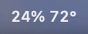
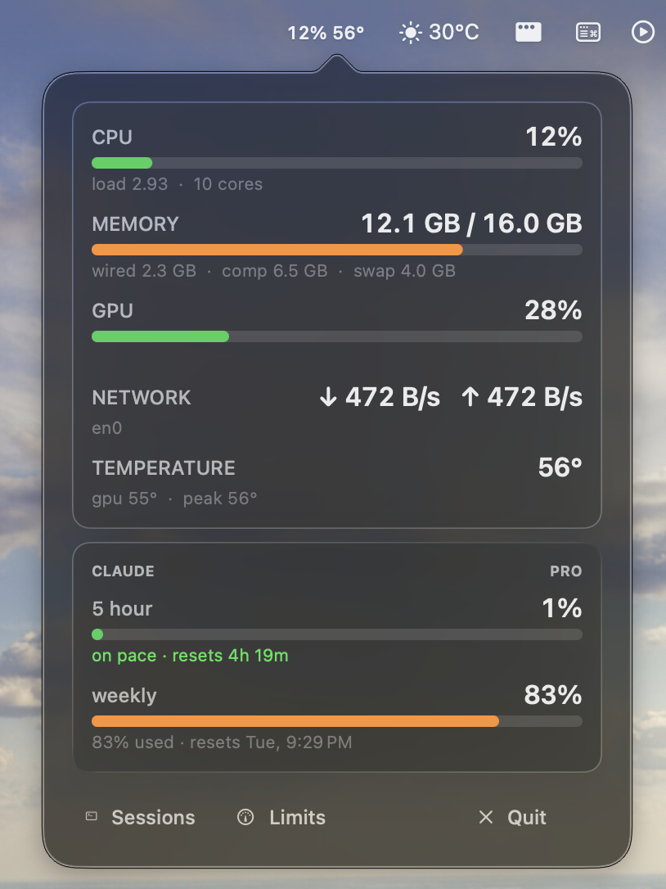
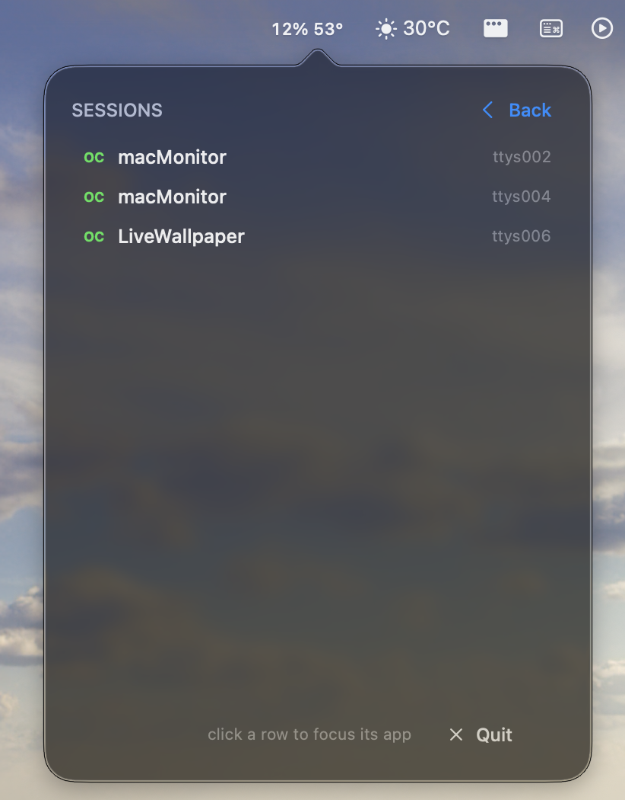

# macmon

A small, always-on macOS menu bar monitor for Apple Silicon. Live CPU, memory, GPU, network, die temperature, and Claude subscription usage. Click the menu bar item to open a Liquid-Glass-style panel.

No history, no charts, no daemon: one `LSUIElement` process, one run loop, no IPC. No special permissions — no Accessibility, no screen recording, no root.

## Install, update, uninstall

`install.sh` is also the update command: it is idempotent and safe to run any time.

### Install from Releases (.dmg)

1. Open the [Releases](../../releases) page and download the latest `macmon-<tag>.dmg`.
2. Open the DMG and drag `macmon.app` to `Applications`.
3. Launch `macmon` once from `Applications`.

### Add to Login Items (manual)

1. Open **System Settings** → **General** → **Login Items & Extensions**.
2. Under **Open at Login**, click **+** and select `Applications/macmon.app`.

## Screenshots

1. Menubar Item

</br>
</br>

2. Window 1 (stats and Claude usage)

</br>
3. Window 2 (active sessions; clicking a row focuses the VS Code / terminal host)

</br>

## The panel

- Click the menu bar item to toggle the panel; click outside or press Escape to close (transient popover).
- **Metrics** — CPU / memory / GPU / network / temperature rows with animated usage bars, plus a Claude usage card (5-hour and weekly windows, plan tag, pace projection).
- **Sessions** — running `claude` / `opencode` sessions with working-directory and tty; click a row to focus its host app.
- **Limits** — thresholds for CPU / MEM / GPU; tap a row to cycle presets. Values persist in `UserDefaults`.
- The panel follows the system light/dark appearance. On macOS 26 inner cards use `NSGlassEffectView` (Liquid Glass); on macOS 14/15 they use a subtle elevated surface.
- The menu bar title shows CPU percent and peak die temperature, e.g. `12% 53°`; a red dot appears while a threshold alert is active.

## Usage

- Closed: samples every 5 s. Open: every 2 s. Sampling pauses when the display sleeps.
- Claude usage polls at most every 5 minutes, backs off on 429s, and shows cached values as `STALE` when offline or rate limited.
- No history is stored. Only the latest sample exists in memory.

## Requirements

- macOS 14 or newer. Liquid Glass card surfaces require macOS 26; older systems get the fallback material automatically.
- Apple Silicon (temperature and GPU readers target Apple Silicon).
- Swift 6 toolchain. Command Line Tools are enough; Xcode is not required.
- No permissions: no Accessibility, no root, no sudo, no entitlements, no sandbox.

## Build

```sh
cd ~/Projects/macMonitor
./scripts/build.sh
```

Produces `build/macmon.app`, signed ad-hoc by default. The bundle icon comes from `Resources/AppIcon.icns`; if it is missing, build.sh stops and asks you to select one:

```sh
./scripts/icons.sh select panes
```

To run the app in development:

```sh
open build/macmon.app
```

Or run the binary directly (it sets accessory activation policy itself):

```sh
.build/release/MacmonApp
```

## Install as a login item

```sh
./scripts/install.sh
```

Copies the app to `~/Applications/macmon.app`, writes `~/Library/LaunchAgents/dev.arkab.macmon.plist` (`RunAtLoad`, `KeepAlive`), and bootstraps it into your GUI session. It starts immediately and on every login.

```sh
./scripts/measure.sh      # pid, RSS, footprint, idle CPU
./scripts/uninstall.sh    # remove app + launch agent, keep cached stats
./scripts/uninstall.sh --purge   # also remove cached stats
```

Your cached Claude percentages in `~/Library/Application Support/macmon/` are preserved by install/uninstall (use `--purge` to clear).

After a reinstall, the Keychain prompt may reappear if the signature changed. Choose Always Allow / re-enable macmon in System Settings.

## Icon

The icon source is `Resources/icons/panes.svg`; the committed bundle icon is `Resources/AppIcon.icns` (generated from it via `scripts/icons.sh`).

```sh
./scripts/icons.sh build        # re-render iconset + .icns from the SVG
./scripts/icons.sh select panes # copy the .icns → Resources/AppIcon.icns
./scripts/icons.sh clean        # remove generated iconsets/icns (keeps the SVG)
```

Rendering uses `rsvg-convert`, ImageMagick, or `qlmanage` (auto-detected, in that order). `build.sh` embeds `Resources/AppIcon.icns` in the bundle, and the release DMG picks it up.

## What it reads

| Metric | Source | Notes |
|---|---|---|
| CPU | `host_processor_info` | total, per-core, load average |
| Memory | `host_statistics64`, `sysctl` | used/wired/compressed/cached, swap, pressure |
| GPU | IOKit `IOAccelerator` → `PerformanceStatistics` | device and renderer utilization |
| Network | `getifaddrs` + `if_data` | `en*` interfaces only; 32-bit counter wrap handled |
| Temperature | SMC (`AppleSMC`) | CPU `Tp*`, GPU `Tg*` sensors, no root |
| Claude | `api.anthropic.com/api/oauth/usage` | 5-hour and weekly utilization, plan, resets |

Temperature and GPU use private/undocumented interfaces. If the OS changes them, the module reports `--` instead of crashing.

## Claude usage and credentials

The app reads the OAuth credentials that Claude Code already stores in your login Keychain:

```
service: "Claude Code-credentials"
```

It uses `SecItemCopyMatching` in-process, keeps the token in memory, and sends it only to `api.anthropic.com/api/oauth/usage` with `User-Agent: claude-code/...`.

What it will not do: write to the Keychain, refresh or rotate the token, log it, or store it. Only utilization percentages, reset timestamps, and the plan name are cached, at:

```
~/Library/Application Support/macmon/claude.json
```

If the token is expired, the app waits for Claude Code to refresh it and shows cached values. If the API is unavailable or rate limited, it estimates the last 5 hours from `~/.claude/projects/**/*.jsonl` and labels the result `LOCAL ESTIMATE`.

Environment overrides:

```sh
CLAUDE_CODE_OAUTH_TOKEN=...   # use an explicit token instead of the Keychain
```

First Keychain read prompts once. Choose **Always Allow**. Rebuilding with an ad-hoc signature changes the binary's identity and triggers the prompt again. To avoid that, create a self-signed code-signing certificate named `macmon-dev` (Keychain Access → Certificate Assistant → Create a Certificate → Code Signing). `build.sh` detects and uses it automatically.

## Permissions

- **Keychain** — read-only access to the Claude Code credentials item, as above.
- Nothing else. No screen recording, no input monitoring, no global event monitors, no network access other than the usage endpoint.

## Claude usage panel

The Claude section never re-reads the Keychain on a timer: credentials are read
once per app lifecycle and only re-read after a 401/403 or when the cached token
is within 60 s of expiry (capped at three forced reloads per lifecycle).

Under the 5-hour bar a projection line summarizes the trend from the last 30
minutes of utilization samples: `exhausted` (red), `runout ~… before reset`
(orange), `hot pace · throttle likely` (yellow, > 25 %/h), `idle · resets …`
(green) or `on pace · resets …` (green). The weekly bar shows
`N% used · resets <day time>`.

### Sessions

`Sessions` in the panel footer opens the session list: running `claude` /
`opencode` processes with their terminal tty and working directory. `opencode`
rows are enriched with title/directory from the local `opencode.db`
(read-only, loaded via dlopen only while the page is open). Clicking a row
focuses the host app: the parent chain of the session process is walked until a
running application is found — VS Code is activated, Terminal/iTerm2 are
activated and the matching tty tab is selected. If no host app resolves, the
click does nothing.

### Threshold limits

`Limits` in the panel footer opens the limits page; tapping CPU / MEM / GPU
cycles through presets (CPU 70–95%, MEM 80–95%, GPU 60–95%); values persist in
`UserDefaults`. While the panel is open, a metric above its limit replaces that
row's detail line with the top offender: the highest-CPU process (with ≥10%
utilization) for CPU, the largest process ≥1 GB for memory, `busy` for GPU
(per-process GPU attribution is not exposed by macOS, so the GPU line stays
generic). Alerts need two consecutive hot samples and clear when usage drops.

## Memory and footprint

Measured on a MacBook Air M5 (16 GB, macOS 26.4), one minute after launch with the panel closed, installed as a LaunchAgent:

| Metric | Value |
|---|---|
| `phys_footprint` closed | 10–21 MB (graphics caches warm or cold) |
| Private dirty | ~7–10 MB |
| RSS | ~39–49 MB (includes shared AppKit/Swift pages) |
| Idle CPU | 0.0–0.4 % (0.1 % steady) |
| Binary size | ~500 KB |
| Peak footprint at first launch | ~58 MB (Swift runtime + URLSession + first Keychain/JSON work) |

RSS overstates a Swift/AppKit app because it counts shared framework pages; use `footprint -p <pid>` for the number that matters. Gates used during development: footprint ≤ 24 MB, private dirty ≤ 8 MB, idle CPU ≤ 0.3 %.

## Development

```sh
swift build -c release

.build/release/MacmonApp --selftest   # pure math/format/geometry checks
.build/release/MacmonApp --probe      # one-shot sensor dump incl. Claude
.build/release/MacmonApp --render /tmp/panel.png   # render the metrics page to PNG
.build/release/MacmonApp --render-sessions /tmp/sessions.png   # render the sessions page to PNG
.build/release/MacmonApp --render-limits /tmp/limits.png   # render the limits page to PNG
MM_RENDER_APPEARANCE=light .build/release/MacmonApp --render /tmp/light.png   # render in light appearance
MM_RENDER_DUMP=1 .build/release/MacmonApp --render /tmp/x.png   # dump the view/layout tree while rendering
.build/release/MacmonApp --toptest    # dump top CPU/MEM processes once
.build/release/MacmonApp --sessions   # print running claude/opencode sessions
MM_DEBUG=1 .build/release/MacmonApp --probe   # verbose SMC discovery/values
MACMON_DEMO=1 .build/release/MacmonApp        # open the panel after 1.5 s
```

There is no XCTest target: Command Line Tools only ship without XCTest, so checks live in `SelfCheck` and run via `--selftest`.

To create a stable signing identity for development:

1. Keychain Access → Certificate Assistant → Create a Certificate.
2. Name `macmon-dev`, type Code Signing, self-signed.
3. Run `./scripts/build.sh`; it picks the identity up.

## Troubleshooting

**Temperature shows `--`.** Run `MM_DEBUG=1 .build/release/MacmonApp --probe`. If SMC discovery fails, the keys may have changed in an OS update; the rest of the app still works.

**Keychain prompt on every rebuild.** Ad-hoc signatures change identity. Use the `macmon-dev` certificate.

**Claude section says STALE or LOCAL ESTIMATE.** The usage endpoint rate-limits undocumented clients. The panel shows the reason. Polling is already floored at 5 minutes with exponential backoff; do not lower it.

**build.sh stops asking for an icon.** Run `./scripts/icons.sh select <name>` once; `Resources/AppIcon.icns` is committed, so CI builds need no SVG renderer.

**Launch agent does not start.**

```sh
launchctl print gui/$(id -u)/dev.arkab.macmon
log show --last 5m --predicate 'process == "macmon"'
```

**Menu bar item is missing.** macOS hides overflow items; remove another item or widen available space.

## Project layout

```
Package.swift
Sources/
  CShims/            C: Mach CPU/memory, IOKit GPU, getifaddrs, SMC
  MacmonCore/
    Models.swift     snapshots and readings
    Samplers.swift   SystemMonitor
    Deltas.swift     counter math
    Formatters.swift byte/rate/temp/countdown formatting
    SelfCheck.swift  built-in checks
    Claude/          Keychain, usage client, JSONL fallback
    Alerts/          thresholds, alert engine, process sampler
    Sessions/        session scanning and focus
    UI/              Theme, components, PanelViewController, MenuBarController
    App/             AppDelegate
  MacmonApp/         main.swift
Resources/
  Info.plist         bundle metadata
  icons/             SVG icon candidates + generated iconsets/previews
  dmg-background.*   DMG backdrop
scripts/             build, icons, install, uninstall, measure
```

## Privacy

No telemetry, analytics, or crash reporting. The only outbound request is the Claude usage GET described above. The only persisted state is the small Claude cache and JSONL read offsets, both in `~/Library/Application Support/macmon/`.

Credentials are never written by this app. If a token is exposed by other means, rotate it with `/logout` + `/login` in Claude Code and revoke the session in claude.ai settings.
